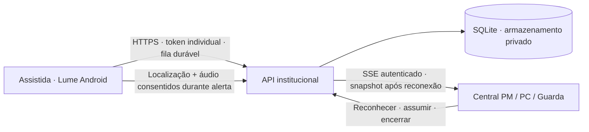

# SOS Mulher V2 · Lume Navegador

Rede de proteção consentida para assistidas e central de atendimento em Ariquemes/RO. Evolução dos projetos [SOS_mulher](https://github.com/andreyquadros/SOS_mulher) e [Painel_SOS_Mulher](https://github.com/andreyquadros/Painel_SOS_Mulher), com a identidade visual fornecida no pacote Mulher–Lume.

**Estado:** implementação para avaliação técnica e homologação. Não há conexão com uma central policial real nesta entrega. A autorização institucional informada pelo solicitante não configura automaticamente servidor, equipe de plantão, assinatura do APK ou homologação nos aparelhos.

## Executar a demonstração

Requisitos: Node.js 24 LTS, npm e Git. O app requer Flutter 3.41.6, JDK 21 e SDK Android.

```sh
npm run setup
npm run dev:demo
```

Abra **http://127.0.0.1:5173**. Conta fictícia: `demo@mulher.ro.gov.br` / `Lume-Demo-2026!`.

Há três ocorrências de treinamento em Ariquemes. O servidor de demonstração força a marcação SIMULADO. Não existe despacho policial ou áudio pré-gravado apresentado como captação real. O banco demo não pode ser aberto em modo de produção.

No painel: cadastre uma assistida fictícia → gere o código de vínculo → no app, Configurações/Área reservada → informe o endereço da API e o código → leia e escolha os consentimentos → confirme a credencial do aparelho → revise permissões → ative o serviço → faça o teste de pressão prolongada com a central aberta.

```sh
node scripts/prepare-voice-model.mjs
cd apps/mobile
flutter pub get
flutter run --dart-define=API_BASE_URL=http://10.0.2.2:3001
```

`10.0.2.2` aponta para o computador no emulador Android. O servidor local escuta apenas loopback; para um aparelho USB, use `adb reverse tcp:3001 tcp:3001` e `http://127.0.0.1:3001`. HTTP só é permitido no APK debug; distribuição exige HTTPS.

## Componentes

| Componente | Implementação |
|---|---|
| Celular | Flutter, navegador WebView real, nome/ícone Lume Navegador, área reservada com credencial do aparelho, vínculo voluntário, pressão de 3s, sequência física e frase opcionais treinadas |
| Segundo plano Android | Serviço Kotlin com notificação Android, frase reconhecida localmente com consentimento, localização e envio de áudio durante ocorrência, fila persistente e reenvio |
| Central | React/TypeScript, mapa Leaflet/OSM com trilha e precisão, sinal antigo, notificações e som opt-in, reconhecimento e responsabilidade separados |
| API | Fastify/TypeScript, SQLite, sessões HttpOnly, perfis e agência, código único, idempotência, concorrência e auditoria |



## O que mudou

- A ocorrência é salva no aparelho antes do envio. A interface diferencia pendência local, confirmação do servidor e atribuição humana.
- Localização inclui horário de captura, horário de recebimento e precisão; reenvio fora de ordem não substitui a posição mais recente.
- O áudio é enviado em blocos independentes de aproximadamente 4 segundos, acessíveis somente a operadores autorizados e com auditoria. Isso oferece acompanhamento com atraso variável; não é uma chamada WebRTC nem uma garantia de latência.
- A fila e a credencial do aparelho persistem fora do ciclo de vida Flutter. A implementação Android usa Android Keystore para os dados sensíveis da fila e do vínculo.
- A central usa eventos contínuos, refaz snapshot após reconexão, distingue dados antigos e exige ativação explícita de som/notificações.
- O nome e o ícone são discretos. A assistida recebe a explicação da função de proteção e mantém a opção de interromper novas capturas. Os indicadores e notificações do Android permanecem.

## Limites de acionamento

Pressão de 3s no app e confirmação genérica pela notificação continuam disponíveis. O [atalho físico opcional](docs/physical-trigger.md) usa um serviço de acessibilidade restrito às teclas de volume, autorizado nas configurações Android, com treino local de 90s sob bloqueio seguro e habilitação real explícita. Não lê tela, não executa gestos e não tira screenshots; declara `isAccessibilityTool=false`.

A sequência é BAIXAR/soltar → SUBIR/soltar → BAIXAR/soltar → segurar SUBIR por 2–4s/soltar, com cliques de até 1s, intervalos de até 1,5s, total de até 10s e cooldown de 30s. O procedimento treinado acende a tela com um toque curto em liga/desliga sem desbloquear; tela totalmente apagada, chamadas, outro filtro de teclas e políticas do fabricante podem impedir o atalho.

O [acionamento por frase](docs/voice-trigger.md) é outra opção explícita: escolha uma das três frases, conclua o treino bloqueado de 90s e autorize separadamente a escuta real com o app aberto. Diga a frase completa, pause em silêncio por 1–2s e repita dentro de 12s. O Vosk reconhece português no aparelho, com tela apagada, enquanto o serviço/microfone se mantêm ativos. Antes de um alerta, PCM e texto ficam só em memória e não são gravados nem enviados. Há indicador de microfone, notificação com ação de parada e consumo adicional de bateria. Não há autenticação de locutora nem imunidade a gravações/TV; homologação acústica é obrigatória. A escuta termina antes da captura AAC de uma ocorrência e não reinicia sozinha.

Após encerramento pelo Android, reative os sensores com o app visível. Um atalho ainda habilitado pode preservar alerta durável sem sensores, mas não inicia um novo foreground service em segundo plano. Pausar o serviço desabilita o atalho; reinício, mudança do sistema e novo vínculo exigem repetir o treino. Economia de bateria, permissões, GPS e rede afetam o funcionamento. Sem resposta do servidor não há confirmação de recebimento pela central; homologação exige modelos físicos e procedimento de atendimento.

## Verificar e implantar

```sh
npm test
npm run build
npm run check:mobile
node scripts/prepare-voice-model.mjs
cd apps/mobile && flutter build apk --debug
```

A CI valida API, painel, análise/testes Flutter, testes JVM Kotlin e APK debug. O APK debug serve à avaliação; não deve ser distribuído como release institucional. A assinatura release exige uma chave externa e o build recusa assinatura debug em produção.

Veja [implantação](docs/deployment.md), [atalho físico](docs/physical-trigger.md), [frase de voz](docs/voice-trigger.md), [homologação](docs/acceptance.md), [arquitetura e migração](docs/architecture.md), [contrato de API](docs/api-contract.md) e [evidências de validação](docs/validation.md). Os ensaios Android isolados usam `npm run test:android:physical` e `npm run test:android:voice`; não substituem homologação física. O modelo português é baixado somente na preparação do build, com SHA256 fixado, e segue dentro do APK para funcionamento offline. Sua licença está nos assets Android; originais de identidade visual em `design/`.

## Identidade e movimento

As marcas V2 foram geradas com image_gen a partir dos assets originais e aplicadas ao painel e ao Android. Originais em design/SOS-Mulher-Lume-assets; novas imagens em [design/generated/v2](design/generated/v2); template, referências e prompts completos em [docs/visual-prompts.json](docs/visual-prompts.json). A galeria visual fica em [http://127.0.0.1:5173/motion-preview.html](http://127.0.0.1:5173/motion-preview.html). As animações são CSS/SVG com fallback estático para movimento reduzido.

A identidade SOS Mulher V3 segue a nova referência visual: mãos de diferentes tons de pele acolhem um celular e um escudo perolado, em 3D com turquesa/ameixa/lavanda. O emblema completo aparece no acesso e na conexão; o símbolo compacto de escudo/bússola atende cabeçalho, rodapé, favicon e notificações. O nome permanece em texto HTML. Os PNGs RGBA originais e a referência estão em [design/generated/v3](design/generated/v3) e [design/references/v3](design/references/v3); prompts do image_gen em [docs/visual-prompts-v3.json](docs/visual-prompts-v3.json). Uma [prévia real do painel](design/previews/v3/panel-login-v3.png) registra a aplicação. O ícone discreto do Lume permanece como navegador.

O ensaio Android instrumental está em apps/mobile/integration_test. Com o servidor demo e o emulador configurados, npm run prepare:e2e cria somente uma pessoa fictícia e uma configuração de vínculo efêmera ignorada pelo Git; execute flutter test integration_test/ com --dart-define-from-file=../../artifacts/e2e-config.json na pasta mobile. Permissões/sensores precisam ser configurados no aparelho de teste.
