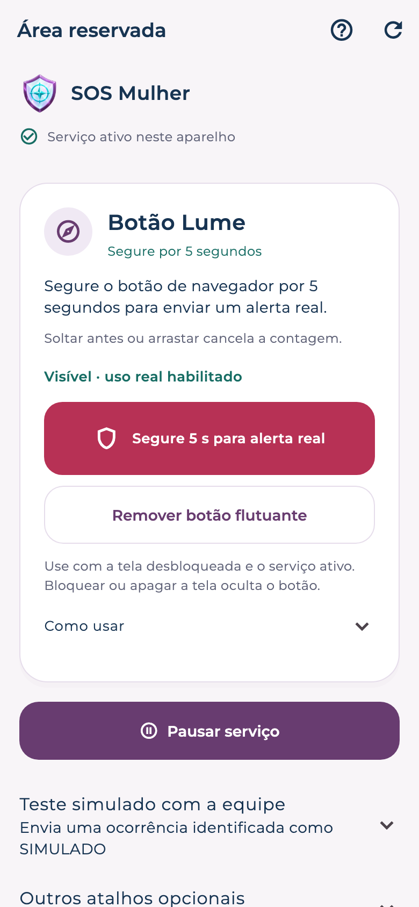

# Botão flutuante Lume · pressão de 5 segundos

O acionamento principal usa um pequeno botão com símbolo de navegador, inicialmente perto do topo da tela. Depois de autorizado pela assistida, ele fica sobre os outros aplicativos enquanto a sessão de proteção está ativa. Não exige serviço de acessibilidade nem escuta por voz.

## Preparar no aparelho

1. Abra o Lume, entre na **Área reservada** e confirme a credencial do Android.
2. Vincule o aparelho à central e escolha os consentimentos. Revise as permissões e ative a proteção com o app visível.
3. No cartão do botão flutuante, abra as configurações do Android e autorize **Aparecer sobre outros apps** para o Lume Navegador. Volte à área reservada.
4. Inicie o treino local. Segure o botão de navegador por **5 segundos contínuos**. Esse treino não cria ocorrência nem envia dados à central.
5. Volte à área reservada e habilite separadamente o botão para alertas reais. O treino sozinho não habilita o envio.

Para solicitar ajuda, mantenha um único dedo no botão até completar os 5 segundos. Soltar antes ou arrastar para reposicionar cancela a contagem. Toques rápidos não enviam alerta. O botão ocupa apenas sua própria área; o restante da tela continua disponível para o outro aplicativo.

O botão dentro da área reservada também exige 5 segundos. Volume e frase continuam disponíveis na seção de opções adicionais, com seus próprios consentimentos e treinos.

## Comportamento e confirmações

- O tempo usa relógio monotônico. Soltar, cancelar o gesto, usar outro dedo, bloquear ou apagar a tela cancela uma pressão incompleta.
- Após um acionamento, há intervalo de 30 segundos contra repetições. A fila durável e o identificador único do evento evitam ocorrências duplicadas durante reenvios.
- O alerta usa o contrato existente `trigger: "hold"`. Localização e áudio seguem os consentimentos e as permissões já concedidos; habilitar o botão não concede acesso adicional aos sensores.
- A área reservada diferencia registro local, recebimento pelo servidor e atendimento humano. O gesto sozinho não confirma recebimento ou despacho policial.
- Pausar a proteção, desvincular ou encerrar o processo remove o botão. Reabrir o app após reinicialização não arma a proteção automaticamente.

## Limites do Android

Esta opção exige **tela acesa e desbloqueada**. O botão é removido durante o bloqueio e não contorna a credencial do aparelho. Não é uma garantia de acesso pela tela de bloqueio.

O sistema pode ocultar sobreposições em telas protegidas, alterar sua posição ou encerrar o processo. A permissão de sobreposição não substitui a sessão de proteção em execução. Se o Android interromper a sessão, abra o Lume e reative a proteção. O botão não mantém a tela acesa nem reinicia sensores sozinho.

Referências oficiais: [janelas de sobreposição](https://developer.android.com/reference/android/view/WindowManager.LayoutParams#TYPE_APPLICATION_OVERLAY), [autorização de sobreposição](https://developer.android.com/reference/android/provider/Settings#canDrawOverlays(android.content.Context)) e [restrições de serviços no Android 15](https://developer.android.com/about/versions/15/behavior-changes-15#fgs-overlays).

## Ensaio reproduzível

Use somente um emulador isolado, sem telefone físico conectado, e a API local em modo de demonstração. O comando limpa apenas a instalação fictícia deste projeto no AVD:

```sh
npm run test:android:floating
```

O driver gera vínculo fictício e fixture privada ignorada pelo Git. A instrumentação opera a janela real em segundo plano e verifica treino, envio e cancelamento; a permissão de sobreposição é concedida apenas pelo ambiente de teste do AVD. Ao terminar, o driver interrompe o app, revoga essa permissão de teste e remove a fixture. Não há exceção de autorização no APK produtivo.

Os resultados e limites do ensaio executado ficam em [evidências de validação](validation.md). O emulador não substitui a homologação em aparelhos físicos, inclusive após economia de bateria e atualização do Android.

Prévia da área reservada, renderizada com os widgets Flutter e dados fictícios:


